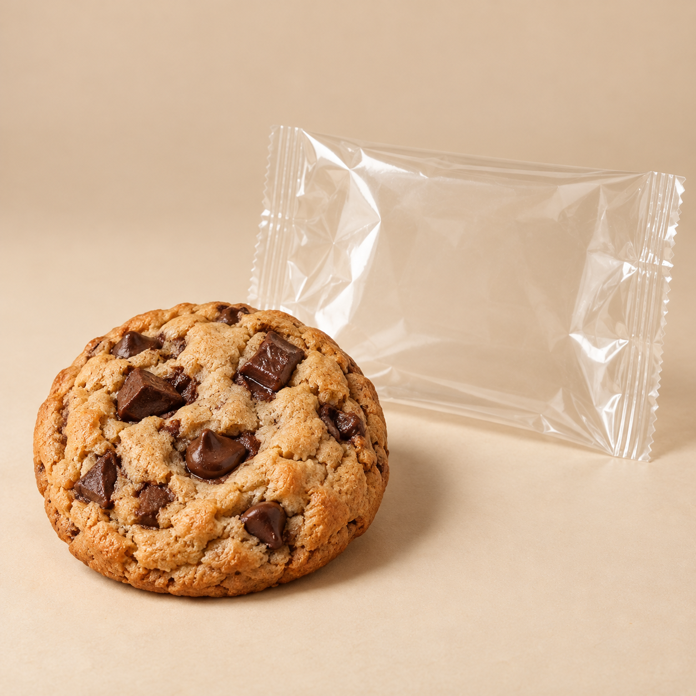
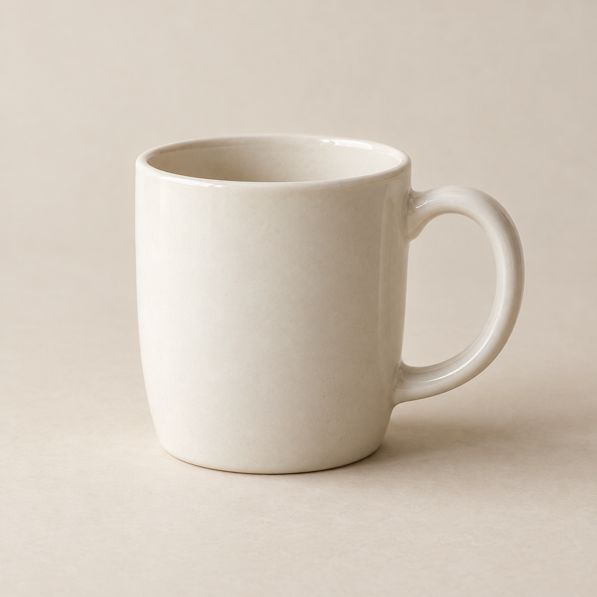

# 제품 3종 프롬프트 실행 결과

`node examples/run.js --save`로 실제 생성한 `rules` 방식 결과다. 이 명령을 다시 실행하면 JSON과 이 문서가 함께 갱신된다.

사진은 입력 상황을 보여주는 합성 테스트 자료다. `rules` 방식은 제품명·설명·분위기 값을 사용하며 사진을 분석하지 않는다. 아래 imageUrl은 업로드 후 바꿔 넣을 자리표시자다. Gemini 사진 분석 결과는 아직 검증하지 않았다.

쿠키는 따뜻한 분위기와 표면·포장, 화장품은 우아한 분위기와 용기·라벨, 머그컵은 차분한 분위기와 윤곽·표면을 강조한다. 모두 10초 연속 장면과 느린 카메라 움직임, 제품·배경 보존 규칙을 포함한다.

## 1. 수제 초콜릿 쿠키



### 입력

```json
{
  "productName": "수제 초콜릿 쿠키",
  "productDescription": "초콜릿 조각이 보이는 쿠키와 포장 사진",
  "imageUrl": "https://example.com/products/cookie.jpg",
  "keySellingPoint": "표면의 초콜릿 조각",
  "targetAudience": "간식을 즐기는 성인",
  "brandTone": "따뜻한"
}
```

### 실제 반환값

```json
{
  "videoPrompt": "Create an inviting food product portrait. Use a warm, welcoming mood with soft lighting consistent with the reference. Use one continuous 10-second shot with a slow, subtle camera push-in, keeping the entire product and label readable. Keep the reference setting and emphasize only the visible surface texture and packaging details. Preserve the reference composition and background, product shape, proportions, colors, label text and logo. Keep the product stationary; avoid rapid motion, cuts, morphing, new objects, added text, invented effects and unsupported product benefits."
}
```

위 `videoPrompt` 문자열을 팀장 모듈의 `prompt`에 그대로 전달한다.

## 2. 데일리 세럼


### 입력

```json
{
  "productName": "데일리 세럼",
  "productDescription": "라벨이 붙은 화장품 용기 사진",
  "imageUrl": "https://example.com/products/cosmetic.jpg",
  "keySellingPoint": "용기와 라벨 디자인",
  "targetAudience": "차분한 디자인을 선호하는 성인",
  "brandTone": "고급스러운"
}
```

### 실제 반환값

```json
{
  "videoPrompt": "Create a restrained beauty product portrait. Use an elegant, restrained mood with soft directional lighting consistent with the reference. Use one continuous 10-second shot with a slow, subtle camera push-in, keeping the entire product and label readable. Keep the reference setting and emphasize only the visible container finish and label details. Preserve the reference composition and background, product shape, proportions, colors, label text and logo. Keep the product stationary; avoid rapid motion, cuts, morphing, new objects, added text, invented effects and unsupported product benefits."
}
```

위 `videoPrompt` 문자열을 팀장 모듈의 `prompt`에 그대로 전달한다.

## 3. 데일리 머그컵



### 입력

```json
{
  "productName": "데일리 머그컵",
  "productDescription": "손잡이가 있는 머그컵 제품 사진",
  "imageUrl": "https://example.com/products/mug.jpg"
}
```

### 실제 반환값

```json
{
  "videoPrompt": "Create a calm everyday product portrait. Use a calm mood with soft balanced lighting consistent with the reference. Use one continuous 10-second shot with a slow, subtle camera push-in, keeping the entire product and label readable. Keep the reference setting and emphasize only the visible silhouette and surface finish. Preserve the reference composition and background, product shape, proportions, colors, label text and logo. Keep the product stationary; avoid rapid motion, cuts, morphing, new objects, added text, invented effects and unsupported product benefits."
}
```

위 `videoPrompt` 문자열을 팀장 모듈의 `prompt`에 그대로 전달한다.
