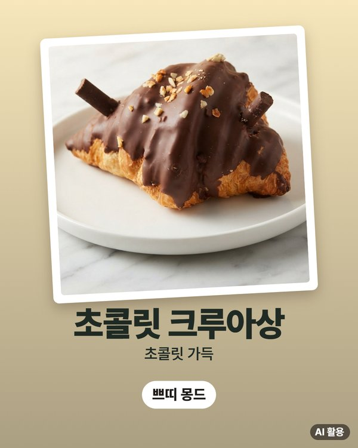
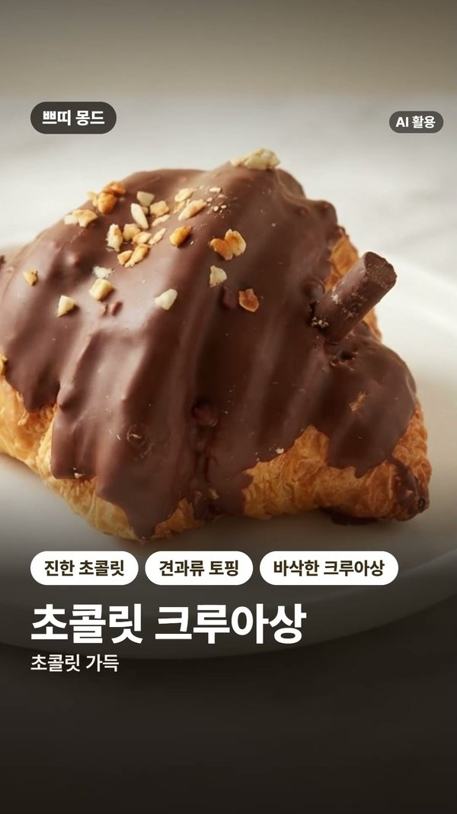
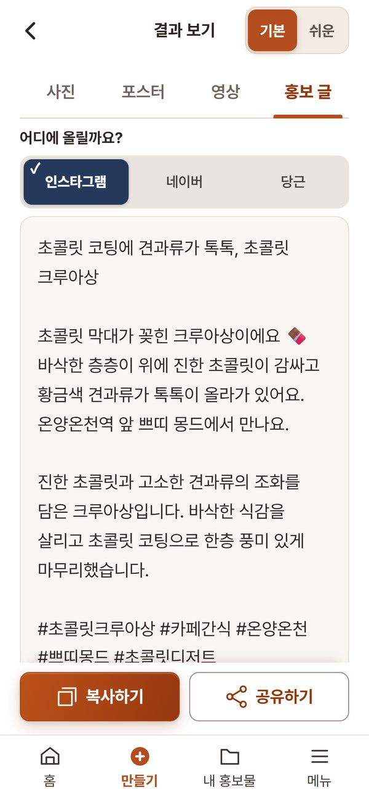
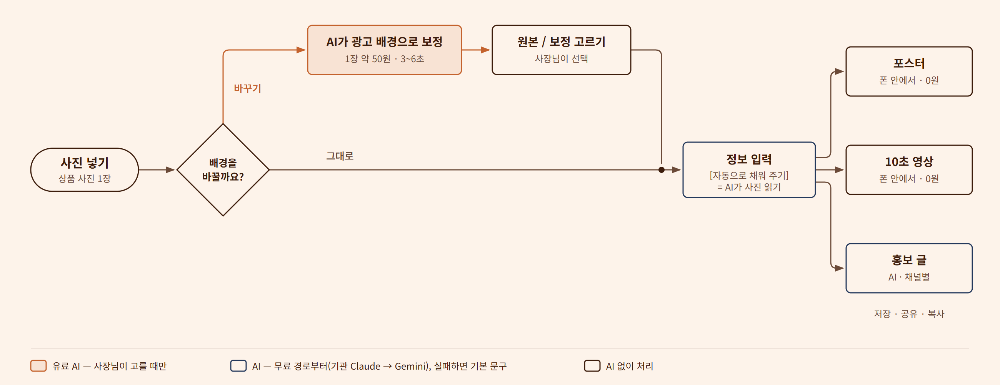

**가게 홍보의 시작을, 더 쉽게.**
상품 사진 한 장으로 포스터, 10초 영상, 홍보 글을 한 번에 만드는 소상공인용 모바일 웹앱입니다. (코디세이 네이티브 과정 파이널 프로젝트)

## 링크

| | 주소 |
|---|---|
| **앱 바로 써 보기** | https://ad-prototype-codyssey.vercel.app — 가입 없이 바로 시작. 사진이 없으면 홈의 예시로 시작 |
| 개인정보처리방침 | [로그인 없이 확인](https://ad-prototype-codyssey.vercel.app/privacy.html) |
| 이용약관 | [로그인 없이 확인](https://ad-prototype-codyssey.vercel.app/terms.html) |
| **발표 자료(웹 슬라이드)** | https://codyseeypresentation.vercel.app — 본편 12장 + 질문 목록 1장 + 질문별 답 20장(A1\~A20) |
| 브랜드 자료 | https://ad-prototype-codyssey.vercel.app/brand-library/ — 지금 쓰는 로고·색·표기 규칙 |
| 개발 문서 | [ad_prototype/docs/README.md](ad_prototype/docs/README.md) |


## 이런 결과물이 나옵니다

실제 앱이 크루아상 사진 한 장으로 만든 결과물입니다(가게 이름 "쁘띠 몽드", 2026-10-22).

| 포스터 | 10초 영상 한 장면 | 홍보 글 |
|---|---|---|
|  |  |  |

## 어떻게 동작하나



**AI는 꼭 필요한 곳에만 씁니다.**

| AI를 쓴 곳 | 일부러 AI를 안 쓴 곳 |
|---|---|
| 사진을 보고 정보 칸 채우기 | 포스터 그리기 |
| 홍보 글 쓰기 | 영상 만들기(폰이 그림을 1초에 30장씩 그려 MP4로 묶음) |
| 배경을 광고 사진처럼 바꾸기(사장님이 고를 때만) | 자막·배경음 |

- 포스터와 영상은 폰 안에서 만들어서 **0원**입니다. 글자가 깨지지 않고, 같은 입력이면 같은 결과가 나옵니다.
- 사진 읽기·홍보 글은 무료 AI로 처리되면 0원, 유료 AI로 넘어가면 1건 약 7\~10원입니다.
- 배경 바꾸기는 1장에 약 50\~53원이고, 원래 사진과 바뀐 사진 중에서 고를 수 있습니다. 홍보물 1건은 배경을 그대로 두면 0\~10원, 바꾸면 약 57\~63원입니다(발표 부록 A3).
- AI가 실패하면 다음 순서로 넘어가서(코디세이 COPA(Claude) → Gemini 무료 → Gemini 유료 → 앱 기본 문구) 결과는 늘 나옵니다.
- AI가 들어간 결과물에는 "AI 활용"을 표시합니다. 포스터·영상·보정 사진에는 그림에, 홍보 글은 복사·공유할 때 안내합니다(인공지능기본법 제31조).

## 팀

| 구분 | 담당자 | 맡은 기능 | 작업 폴더 |
|---|---|---|---|
| A | 손용범 | UI/UX 화면 설계(기본·쉬운 화면, 결과 탭), 모듈 통합, 배포 | [A_손용범](A_손용범/) |
| B | 이창훈 | AI 홍보 글 규칙(채널별 글, 금지어, 문구 후보, 영상용 짧은 제목) | [B_이창훈](B_이창훈/) |
| C | 김만복 | 제품 정보 입력 화면, 사진 형식·크기 검사, 글자 수 제한 | [C_김만복](C_김만복/) |
| D | 고혜숙 | 포스터 렌더러(크기·배치·색, 파일 이름 규칙) | [D_고혜숙](D_고혜숙/) |
| E | 이채원 | 영상 연출 규칙, 업종별 연출 방향, 시장조사·통계 출처·개발 목적 자료 | [E_이채원](E_이채원/) |
| F | 육성준 | 사용자 관점 점검, 코드 리뷰와 QA 의견 | [F_육성준](F_육성준/) |

## 폴더 구조

```
A_손용범/ ~ F_육성준/   팀원별 작업 원본
ad_prototype/           팀원 작업을 하나로 합친 앱 (React + Vite, Vercel 함수, Supabase)
ad_prototype/docs/      개발 문서 4개
```

## 개발자용

- 기술: React 19 + TypeScript · Vite · Canvas/WebCodecs(폰 안에서 포스터·영상) · Vercel 함수 · Supabase(로그인·저장) · 코디세이 COPA(Claude)·Gemini
- 키 없이 실행해 보기: `cd ad_prototype` → `npx -y pnpm@9.15.9 install` → `npm run dev:mock`(가짜 AI 답으로 동작)
- 로그인: 카카오·이메일·Google을 지원합니다. Google은 2026-11-08 외부 사용자용 프로덕션으로 전환했고, 테스트 사용자에 등록하지 않은 계정의 로그인 성공을 확인했습니다. 가입 없이 "바로 시작하기"로도 씁니다.
- 개인정보처리방침과 이용약관은 홈 하단 링크 또는 위 공개 주소에서 로그인 없이 확인할 수 있습니다. Google 홈페이지 소유권 확인도 완료했으며, 브랜딩 수동 검토는 로그인 사용 가능 상태와 별개로 진행 중입니다(2026-11-08 확인).

실행 방법, 키 설정, 점검 명령, 배포는 [ad_prototype/docs/README.md](ad_prototype/docs/README.md)에 있습니다.
