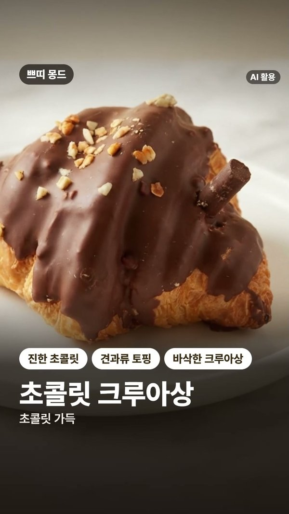
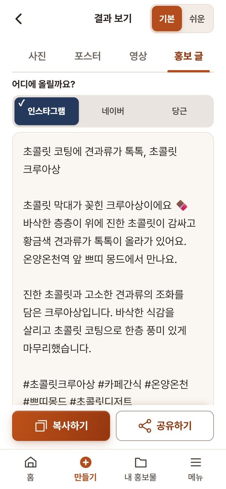
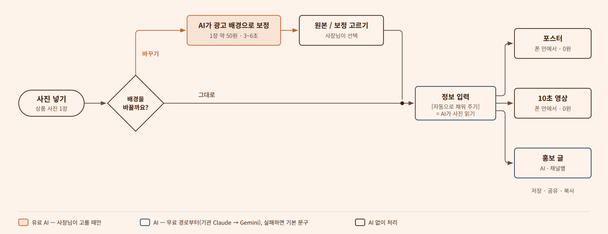

**가게 홍보의 시작을, 더 쉽게.**
상품 사진 한 장으로 포스터, 10초 영상, 홍보 글을 한 번에 만드는 소상공인용 모바일 웹앱입니다. (코디세이 네이티브 과정 파이널 프로젝트)

## 링크

| | 주소 |
|---|---|
| **앱 바로 써 보기** | https://ad-prototype-codyssey.vercel.app — 가입 없이 바로 시작. 사진이 없으면 홈의 예시로 시작 |
| **발표 자료(웹 슬라이드)** | https://codyseeypresentation.vercel.app — 본편 12장 + 예상 질문 목록과 답 16장(A0~A15) |
| 브랜드 자료 | https://ad-prototype-codyssey.vercel.app/brand-library/ — 지금 쓰는 로고·색·표기 규칙 |
| 개발 문서 | [ad_prototype/docs/README.md](ad_prototype/docs/README.md) |


## 이런 결과물이 나옵니다

실제 앱이 사진 한 장("쁘띠 몽드 초콜릿 크루아상")으로 만든 결과물입니다(2026-10-22).

| 포스터 | 10초 영상 한 장면 | 홍보 글 |
|---|---|---|
|  |  |  |

## 어떻게 동작하나



**AI는 꼭 필요한 곳에만 씁니다.**

| AI를 쓴 곳 | 일부러 AI를 안 쓴 곳 |
|---|---|
| 사진을 보고 정보 칸 채우기 | 포스터 그리기 |
| 홍보 글 쓰기 | 영상 만들기(폰이 그림을 1초에 30장씩 그려 MP4로 묶음) |
| 배경을 광고 사진처럼 바꾸기(사장님이 고를 때만) | 자막·배경음 |

- 포스터와 영상은 폰 안에서 만들어서 **0원**입니다. 글자가 깨지지 않고, 같은 입력이면 같은 결과가 나옵니다.
- 배경 바꾸기는 1장에 약 50원이고, 원래 사진과 바뀐 사진 중에서 고를 수 있습니다.
- AI가 실패하면 다음 순서로 넘어가서(기관 Claude → Gemini → 앱 기본 문구) 결과는 늘 나옵니다.
- AI가 들어간 결과물에는 "AI 활용"을 표시합니다. 포스터·영상·보정 사진에는 그림에, 홍보 글은 복사·공유할 때 안내합니다(인공지능기본법 제31조).

## 팀

| 구분 | 담당자 | 맡은 기능 | 작업 폴더 |
|---|---|---|---|
| A | 손용범 | UI/UX 화면 설계(기본·쉬운 화면, 결과 탭), 모듈 통합, 배포 | [A_손용범](A_손용범/) |
| B | 이창훈 | AI 홍보 글 규칙(채널별 글, 금지어, 문구 후보, 영상용 짧은 제목) | [B_이창훈](B_이창훈/) |
| C | 김만복 | 제품 정보 입력 항목·글자 수 제한, 입력 화면 | [C_김만복](C_김만복/) |
| D | 고혜숙 | 포스터 렌더러(크기·배치·색, 파일 이름 규칙) | [D_고혜숙](D_고혜숙/) |
| E | 이채원 | 영상 연출 규칙, 장면 프롬프트, 업종별 연출 방향, 시장조사·기획 의도 | [E_이채원](E_이채원/) |
| F | 육성준 | QA 피드백, 결과 화면 개선 요청, 사용자 관점 점검 | [F_육성준](F_육성준/) |

## 폴더 구조

```
A_손용범/ ~ F_육성준/   팀원별 작업 원본
ad_prototype/           팀원 작업을 하나로 합친 앱 (React + Vite, Vercel 함수, Supabase)
ad_prototype/docs/      개발 문서 5개
```

## 개발자용

실행 방법, 키 설정, 점검 명령, 배포는 [ad_prototype/docs/README.md](ad_prototype/docs/README.md)에 있습니다.
