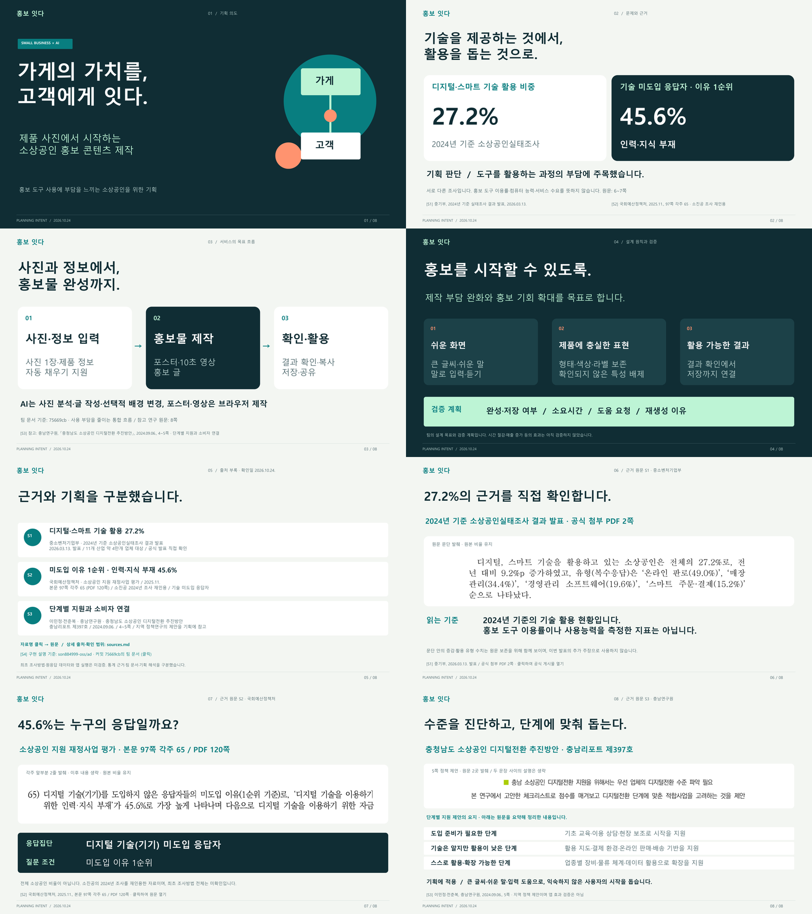

# 홍보 잇다 — 기획 의도 발표자료

제품 사진과 간단한 정보로 소상공인의 홍보 콘텐츠 제작 부담을 낮추려는 기획을 설명합니다. 본문 4장, 출처 목록 1장, 근거 원문 3장으로 구성한 총 8장 자료입니다.

## 자료 열기

- **[발표 원본 PPTX](planning_intent.pptx)** — 발표자 노트와 편집 가능한 텍스트·도형 포함
- **[배포용 PDF](planning_intent.pdf)**
- [기획 의도와 발표 멘트](planning_intent.md)
- [출처와 확인 범위](sources.md)
- [검수 기록](verification.md) · [자동 검사 결과](checks.json)



통계와 팀의 기획 해석을 구분합니다. 전체 서비스의 통합 완료나 매출·시간 절감·폐업 감소 효과를 검증한 보고서가 아닙니다. 구현 설명은 기획 문서에 명시한 팀 저장소 커밋의 문서를 기준으로 합니다.

## 폴더 구성

| 파일 | 용도 |
| --- | --- |
| `planning_intent.pptx`, `planning_intent.pdf` | 발표·배포 자료 |
| `planning_intent.md`, `sources.md`, `verification.md` | 문안·출처·검증 한계 |
| `preview.png`, `slide_01.png` ~ `slide_08.png` | 전체·개별 슬라이드 미리보기 |
| `evidence/` | 공식 원문 PDF, 발췌 이미지, 다운로드·발췌 기록 |
| `prepare_evidence.py`, `build_planning_intent.py` | 근거 확보와 발표자료 재생성 |
| `requirements.txt`, `checks.json` | 의존성 버전과 자동 검사 결과 |

## 재생성

Windows 및 맑은 고딕 글꼴이 필요합니다. 저장소 루트에서 다음 명령을 실행합니다.

```powershell
python -m pip install --target .pt_deps -r pt_materials_planning_intent/requirements.txt
python -X utf8 pt_materials_planning_intent/build_planning_intent.py
```

보관된 `evidence/`의 PDF를 사용하므로 발표자료 재생성에 원문 재다운로드는 필요하지 않습니다. 원문을 다시 확보하려는 경우에만 아래 명령을 실행합니다. 공식 사이트의 주소·내용이 변경될 수 있으므로 재다운로드 후 출처와 발췌 결과를 확인합니다.

```powershell
python -X utf8 pt_materials_planning_intent/prepare_evidence.py
```

재생성하면 이 폴더의 PPTX·PDF·슬라이드 이미지·발췌 기록·자동 검사 결과를 덮어씁니다. PDF는 PPTX를 PowerPoint에서 내보낸 파일이 아니라 같은 문안과 좌표를 별도로 렌더링한 결과입니다. PowerPoint 자체 렌더링은 검증하지 않았습니다.

`.pt_deps/`는 로컬 의존성 폴더로 업로드 대상에서 제외합니다. 최종 파일명은 `planning_intent.pptx`로 통일합니다.
